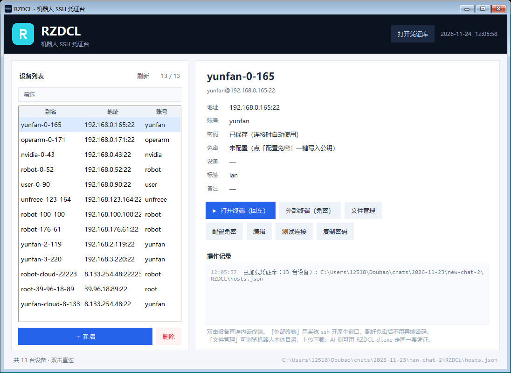
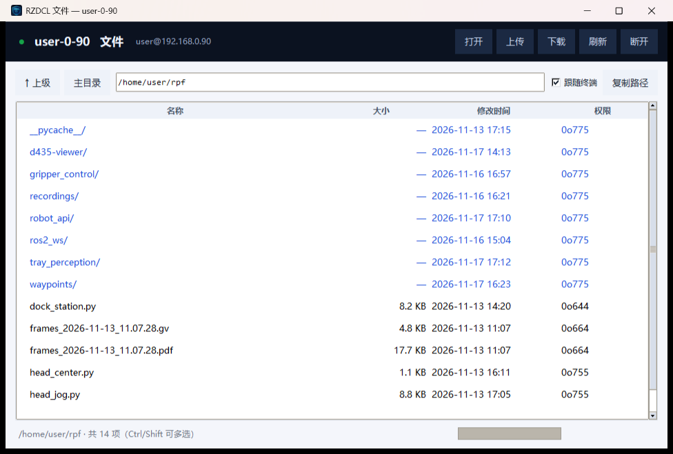

# RZDCL · 机器人 SSH 凭证台

把机器人、开发板、服务器的 SSH 凭证集中存起来的小工具：双击设备直连终端、外部终端真免密、SFTP 直接看机器人本体文件、还开放命令行给 AI 读凭证跑命令。

Windows / Ubuntu 双平台，同一份源码，单文件可执行免安装。



## 下载（免安装）

成品在 [Releases](https://github.com/rzdcl/ssh/releases/latest) 里，不用装 Python：

| 文件 | 平台 | 说明 |
|---|---|---|
| `RZDCL.exe` | Windows x64 | 图形界面主程序，双击即用 |
| `RZDCL-cli.exe` | Windows x64 | 命令行版，给 AI / 脚本读凭证跑命令 |
| `RZDCL-linux-x86_64` | Ubuntu 22.04+ | 图形界面，`chmod +x RZDCL-linux-x86_64` 后运行 |
| `RZDCL-cli-linux-x86_64` | Ubuntu 22.04+ | 命令行版，同样先 `chmod +x` |

凭证库 `hosts.json` 不在仓库里（含真实密码），自己放一份到程序同级目录即可自动读取。

## 功能

| | 说明 |
|---|---|
| 凭证库 | `hosts.json` 存别名 / 地址 / 端口 / 账号 / 密码 / 设备 / 标签 / 备注，便携模式（放程序同级即自动读取） |
| 内嵌终端 | 双击设备直连，逐条命令模式，↑↓ 历史、Ctrl+L 清屏、`sudo` 交互与中断都支持 |
| 外部终端 | 开原生 ssh 窗口，`top` / `vim` / `htop` 可用；配好公钥免密后**不再弹密码** |
| 真免密的硬骨头 | Windows 的 ssh 会因私钥 ACL 过宽直接忽略密钥（`Bad permissions`），程序自动 `icacls` 收紧并对 `ssh` 实测一次才算成功；Linux 侧走 `chmod 600` |
| 文件管理 | SFTP 浏览 / 上传（多选、整目录递归）/ 下载 / 打开远端文件（拉本地缓存后回传）/ 删除 / 进度条 |
| 跟随终端 | 每 1.5 秒采样远端各 shell 的 CPU 时间，谁刚动就取谁的 `/proc/<pid>/cwd`，内嵌终端和系统 ssh 窗口都能跟上，不改远端任何配置 |
| 命令行 | `RZDCL-cli`：`list` / `get` / `run` / `ls` / `cat` / `upload` / `download` / `setup-key`，AI 与脚本可直接消费 |



## 快速上手

```bash
# Windows
RZDCL.exe

# Ubuntu 22.04+（x86_64）
chmod +x RZDCL RZDCL-cli && ./RZDCL
```

把 `hosts.example.json` 复制成 `hosts.json`，按自己设备改一改即可。凭证库查找顺序：`--config` → `ROBOT_VAULT` 环境变量 → 程序同级 `hosts.json` → `%APPDATA%\RZDCL\hosts.json`（Linux 为 `~/.config/RZDCL/`）。

## 从源码构建

Windows（Python 3.11 + 官方安装版带 tkinter）：

```powershell
pip install paramiko pyinstaller
.\build\build.ps1
```

Ubuntu（Python 3.10 + tkinter）：

```bash
sudo apt install -y python3-tk
python3 -m pip install --user paramiko pyinstaller
python3 -m PyInstaller --onefile --name RZDCL --add-data "assets:assets" rzdcl_console.py
python3 -m PyInstaller --onefile --name RZDCL-cli rzdcl_cli.py
```

图标由 `build\word_icon.py`（字标）+ `build\final_assets.py`（多尺寸 ico）生成，不依赖外部设计稿。

## 目录

```
rzdcl_core.py      核心：凭证读写、免密密钥、会话、SFTP、外部 ssh 参数、shell cwd 采样
rzdcl_console.py   GUI：主窗口 / 终端窗口 / 文件管理窗口
rzdcl_cli.py       命令行版
assets/            图标（字标 PNG / 多尺寸 ICO / 顶栏徽标）
build/             打包脚本、版本信息、图标生成脚本
ubuntu/            Linux 说明
使用说明.md         完整使用与排错文档
```

## 安全说明

- 本仓库**不含任何真实凭证**：`hosts.json`、`keys/`、备份包都不进版本库（见 `.gitignore`），只放一个 `hosts.example.json` 模板。
- 免密密钥是本机生成、本机保存，不会随仓库分发。
- 用别人的凭证库时注意 `hosts.json` 里的密码是明文存储，建议只放在自己的机器上。

## 已知边界

- 免密只能覆盖「公钥登录」；对方 `sshd_config` 里 `PubkeyAuthentication no` 时配不上，程序会提示。
- Ubuntu 版在 22.04 及以上可用（glibc 2.35）；20.04 及更早会因 glibc 版本不够起不来。
- 跟随终端依赖远端存在 `/proc/<pid>/cwd` 与 `bash/zsh/sh/fish` 之类 shell，极端精简的嵌入式系统可能取不到。
