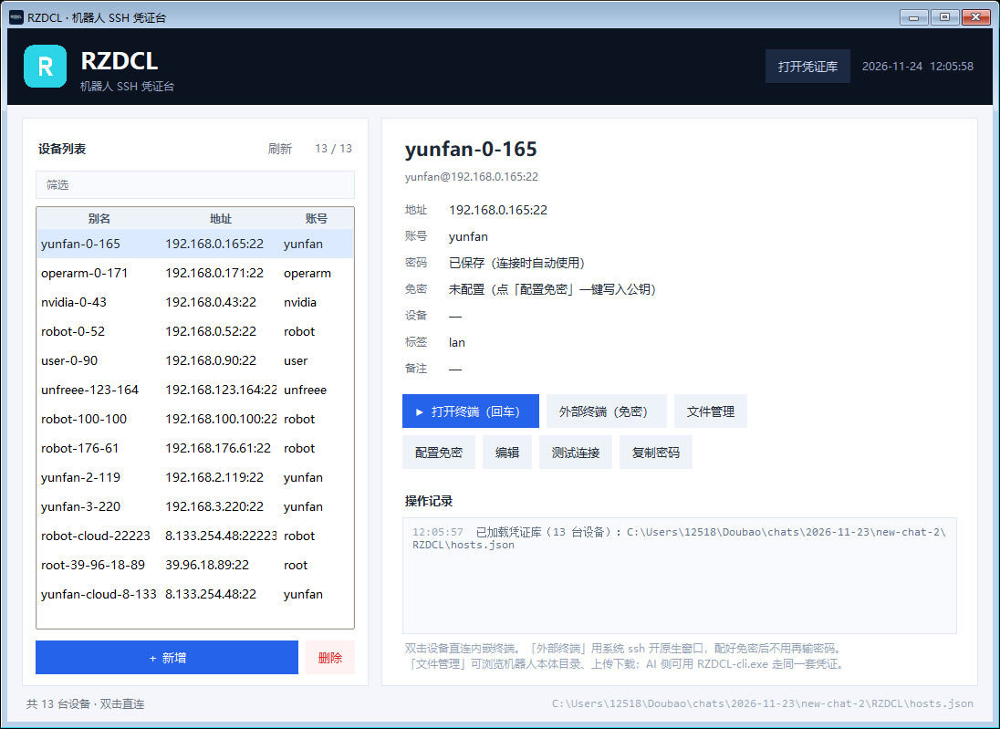
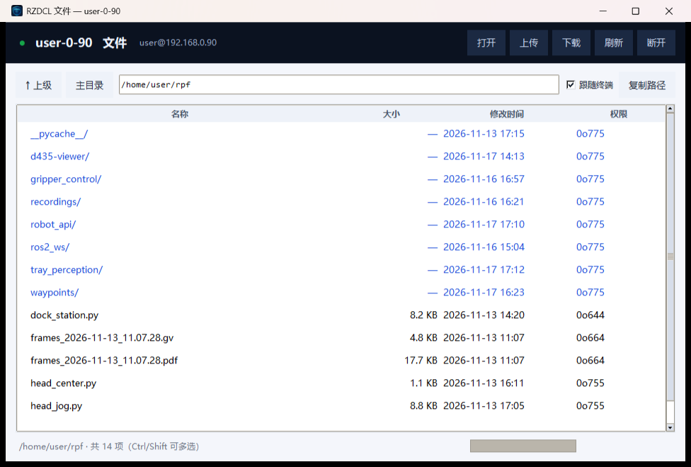

# RZDCL —— 机器人 SSH 凭证台

上位机小工具：把机器人 / 开发板 / 服务器的 SSH 凭证存起来，双击就直连终端；外部终端配好免密后不用输密码；能直接浏览机器人本体文件。凭证库同时开放给 AI 用命令行读取。



## 目录里有啥

| 文件 | 用途 |
|---|---|
| `RZDCL.exe` | 图形界面主程序（双击运行，单文件免安装） |
| `RZDCL-cli.exe` | 命令行版，给 AI / 脚本读凭证、跑命令、传文件 |
| `ubuntu\RZDCL` | Ubuntu / Linux 版图形界面（同一份源码编出来的，`ubuntu\` 里另有 `RZDCL-cli` 和 Linux 说明） |
| `hosts.json` | 凭证库（13 台设备，便携模式：放 exe 同级就自动读取） |
| `keys\` | 本机免密密钥（首次点「配置免密」时自动生成，别外发） |

## 图形界面怎么用

1. 双击 `RZDCL.exe`（首次启动解压约 2 秒）。
2. 左侧设备列表，**双击设备或选中后按回车** → 打开内嵌终端，存过密码的自动登录。
3. 内嵌终端：命令逐条执行，↑↓ 翻历史、Ctrl+L 清屏、`sudo` 交互和「中断」按钮都支持。
4. **外部终端（免密）**：开一个 Windows 原生 ssh 窗口，`top`/`vim`/`htop` 都能用。
   - 第一次点会先自动配置免密：用存的密码登录一次，把本机公钥追加到机器人 `~/.ssh/authorized_keys`（目录 700、文件 600，改动前留一份 `.rzdcl.bak`）。
   - 点之前会先用 `ssh.exe` 实测一次密钥登录，确认真能免密才开窗；万一没通过，会弹窗说明原因并问你要不要退回普通窗口。
   - 程序会自动把 `keys\id_ed25519` 的权限收紧成“只有当前用户可读”（`icacls /inheritance:r`）。**这一步很关键**：Windows 的 ssh 一旦发现私钥还能被别的用户/组读到，就会打印 `Bad permissions / UNPROTECTED PRIVATE KEY FILE`，直接忽略这把密钥并弹密码框，看起来就像免密没生效。
   - 设备详情里的「免密」一行显示“已配置 / 未配置”，状态会写回 `hosts.json`。
5. **配置免密**：单独给某台设备补配免密（幂等，已经配过的会重新校验，同时顺手修密钥权限）。要求该设备已存密码，否则先「编辑」补上。
6. **文件管理**：SFTP 窗口，浏览机器人本体目录、上传下载、直接打开远端文件。
   - 双击目录进入；**双击文件 = 直接打开**（先取到本地缓存 `%TEMP%\RZDCL\<别名>\`，再用系统默认程序打开，改完可以回传）。
   - **路径框可以直接输入**：敲完回车就跳过去，支持 `~/rpf`、`/home/user/xxx`、相对路径；Esc 撤回原路径。不想敲也可以点「↑ 上级」「主目录」。
   - **跟随终端**：勾着「跟随终端」时，远端哪个 shell 刚被敲过命令，文件窗口就跳到哪个目录——内嵌终端、系统 ssh 开的窗口都算（做法是每 1.5 秒采样各 shell 进程的 CPU 时间，谁刚动取谁的 `/proc/<pid>/cwd`，不改远端任何配置）。从终端点「文件管理」打开时，会直接落在终端当前目录。自己手动跳的目录不会被立刻拽回去。
   - 支持 Ctrl / Shift 多选：多选后「下载」会让你选一个文件夹，一次全下来。
   - 「上传」支持多选文件；右键「上传文件夹到当前目录」可整目录递归传（自动建远端目录）。
   - 传输过程底部有进度条和百分比，卡住/失败会在状态行写清原因。
   - 右键菜单：打开文件 / 下载到… / 用本地副本回传覆盖（远端旧版自动存 `.rzdcl.bak`）/ 上传文件 / 上传文件夹 / 复制远程路径 / 删除（仅文件）/ 刷新。
   - 和终端用同一套登录（有免密直接进，没有免密用密码）。


7. 其他：新增 / 编辑 / 删除 / 测试连接（TCP 探测）/ 复制密码 / 刷新（手工改过 `hosts.json` 后点一下）。

### 免密配不上的情况

少数机器人关了公钥登录，或者 home 目录不可写，这时外部终端会退回“普通 ssh 窗口 + 密码已复制到剪贴板”，并在弹窗里说明原因。要在机器人上解决的话：

```bash
sudo grep -i pubkey /etc/ssh/sshd_config     # 应为 PubkeyAuthentication yes
sudo systemctl restart ssh
```

## AI / 脚本怎么用（RZDCL-cli.exe）

和 GUI 共用同一份 `hosts.json` 和同一把密钥，所以在 shell 里（或让 AI）直接：

```powershell
.\RZDCL-cli.exe list                      # 列出 13 台设备
.\RZDCL-cli.exe list --json               # JSON（给程序解析）
.\RZDCL-cli.exe list --json --show-password   # 带密码的 JSON
.\RZDCL-cli.exe get yunfan-0-165          # 单台详情

.\RZDCL-cli.exe run yunfan-0-165 --cmd "uname -a && ip -br a"
.\RZDCL-cli.exe ls yunfan-0-165 /home/yunfan
.\RZDCL-cli.exe cat yunfan-0-165 /etc/hostname
.\RZDCL-cli.exe download yunfan-0-165 /home/yunfan/log.txt .\log.txt
.\RZDCL-cli.exe upload yunfan-0-165 .\test.py /home/yunfan/test.py
.\RZDCL-cli.exe setup-key yunfan-0-165     # 写入公钥，之后免密
.\RZDCL-cli.exe keys                      # 看密钥路径和公钥内容
```

- 返回码：`run` 直接透传远端命令的退出码，失败可以用 `if ($LASTEXITCODE -ne 0)` 判断。
- 匹配设备时给别名最稳；给 IP 或备注片段也行，命中多台会报错并列出候选，不会瞎连。
- 指定别的凭证库：`--config D:\path\hosts.json`，或设环境变量 `ROBOT_VAULT`。

## 凭证库 / 密钥放哪

- 凭证库：优先 exe 同级 `hosts.json`（便携模式，整个文件夹拷到别的电脑也能用）；没有则依次看 `--config`、环境变量 `ROBOT_VAULT`、`%APPDATA%\RZDCL\hosts.json`。
- 密钥：优先 exe 同级 `keys\`，不可写时落到 `%APPDATA%\RZDCL\keys`。换电脑后免密要重新配一遍（公钥属于“这台电脑”）。
- 字段与原来的凭证库完全兼容：`alias / host / port / user / password / device / tags / note`，新增 `key`（是否已配免密）。

## 注意

- 要和机器人在同一网络（同路由器 / VPN）才能连；跨网段连不上时窗口会直接给出错误原因。
- 密码是明文存在 `hosts.json`，`keys\id_ed25519` 是私钥，两个都只放自己电脑，别上传别外发。
- 内嵌终端是“逐条命令”模式，长时间输出（`apt install`）会刷到最后才停，中途可以点「中断」。
- 改源码后重新打包：`. \build\build.ps1`（会同时生成 `RZDCL.exe` 和 `RZDCL-cli.exe` 并跑自检）。

## Ubuntu / Linux 版

`ubuntu\` 目录里是同一份源码编出来的 Linux 可执行（Ubuntu 22.04 及以上，x86_64）：

```bash
cd ubuntu && chmod +x RZDCL RZDCL-cli && ./RZDCL
```

平台差异都在代码里按 `os.name` 分支，没有分叉维护：

| 项目 | Windows | Ubuntu |
|---|---|---|
| 私钥权限 | `icacls` 收紧 ACL | `chmod 600` |
| 外部终端 | 新开控制台跑 `ssh.exe` | 自动挑 gnome-terminal / konsole / xfce4-terminal / tilix / xterm |
| 打开远端文件 | 系统默认程序 | `xdg-open` |
| 中文字体 | 微软雅黑 | 自动挑系统里可用的 Noto / 文泉驿 / 思源 |

Linux 侧两个常见坑：对方 `sshd_config` 里 `PubkeyAuthentication yes`；系统缺中文字体时 `sudo apt install -y fonts-noto-cjk`。命令行版用法与 Windows 完全一致，把 `hosts.json` 拷到二进制旁边即可。